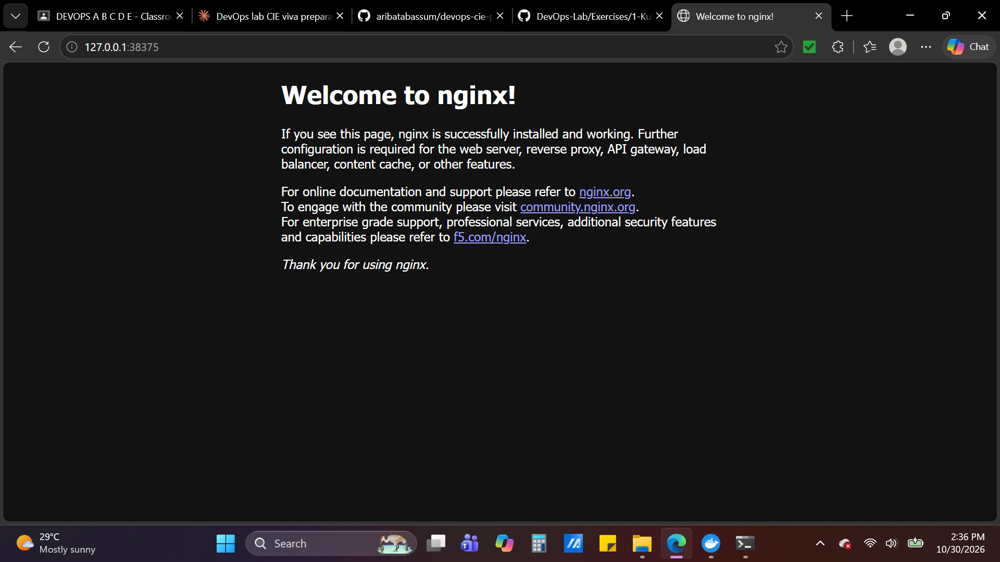

# Exercise 1 - Hello Pod

Deployed an nginx Pod on Minikube, exposed it with a NodePort Service, and accessed it in the browser.

## Commands used
minikube start
kubectl run hello-k8s --image=nginx --port=80
kubectl get pods
kubectl expose pod hello-k8s --type=NodePort --port=80
minikube service hello-k8s

## Result

